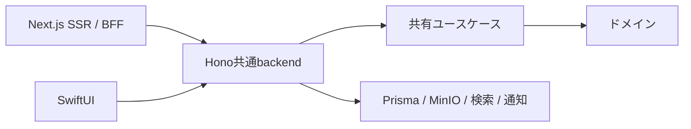

# アーキテクチャ

## 目次
- [クリーンアーキテクチャの構成](#クリーンアーキテクチャの構成)
- [ドメインモデル](#ドメインモデル)
- [コードスタイルとアーキテクチャルール](#コードスタイルとアーキテクチャルール)
- [セキュリティ](#セキュリティ)
- [Authorization Pattern](#authorization-pattern)
- [i18n Pattern](#i18n-pattern)
- [Loader Pattern](#loader-pattern)
- [Error Boundary Pattern](#error-boundary-pattern)
- [静的 CSP と Instant Navigation](#静的-csp-と-instant-navigation)
- [Dynamic Rendering](#dynamic-rendering)
- [Server Actions Architecture Pattern](#server-actions-architecture-pattern)
- [Value Object Pattern with Zod Branding](#value-object-pattern-with-zod-branding)
- [Domain Entity Creation Pattern](#domain-entity-creation-pattern)
- [Server-Side Error Handling Pattern](#server-side-error-handling-pattern)
- [Form Data Parsing Pattern](#form-data-parsing-pattern)
- [Client Form Pattern](#client-form-pattern)
- [Cache Invalidation Pattern](#cache-invalidation-pattern)
- [Data Fetching Pattern](#data-fetching-pattern)
- [DTO Transform Pattern](#dto-transform-pattern)
- [Event-Driven Architecture Pattern](#event-driven-architecture-pattern)
- [Repository CQRS Pattern](#repository-cqrs-pattern)
- [Dependency Injection Factory Pattern](#dependency-injection-factory-pattern)
- [Workspace task graph](#workspace-task-graph)

## クリーンアーキテクチャの構成

共有Application/Infrastructureへの段階的な責務分離は[backend責務の整理](backend-layer-refactoring.md)を参照する。

Web、iOS、共通backendの責務を分離する。Webからドメイン・DB・storageへの直接依存はdependency-cruiserの `boundary-web-frontend-only` で禁止する。

| 配置 | 責務 |
|------|------|
| `packages/core/` | ドメインごとのエンティティ、値オブジェクト、repository interface、ドメインサービス |
| `apps/backend/` | Hono HTTP host、環境設定・DI、ユースケース、Prisma adapter、認証・tenant、同期・upload、検索、イベント、通知・Cron |
| `packages/api-contracts/` | HonoルートとZodによるHTTP契約。core・ORM・Next.jsに依存しない |
| `packages/api-client/` | Orval生成のDTO・検証schema・fetchと共通transport |
| `apps/web/src/application-services/` | WebのServer Action。生成client呼び出し、フォーム値・表示エラー変換、画面更新 |
| `apps/web/src/common/backend/` | Cookieをリクエスト単位で束縛するSSR clientと固定upstreamへのBFF転送 |
| `apps/web/src/infrastructures/` | Webのi18n・ブラウザ認証・セキュリティ等。PrismaやドメインDIを置かない |
| `apps/ios/` | Swift生成client、端末の表示・同期・保留中の項目 |



各ドメイン間の直接importは禁止し、共通要素はshared-kernelへ置く。repositoryはcoreのinterfaceを実装し、外部設定はhostで構成する。Web用Sentryとbackend用Sentryはそれぞれの実行環境で扱う。
移行履歴は[共通backend移行](backend-migration.md)、手動配置は[Vercelセットアップ](backend-vercel-setup.md)を参照する。

## ドメインモデル

ドメインモデルの詳細（エンティティ、ステータスライフサイクル、集約境界、Application Service層）については [docs/domain-model.md](domain-model.md) を参照してください。

スキーマは `packages/database/prisma/schema.prisma` で管理されています。

## コードスタイルとアーキテクチャルール

### フォーマッターとリンター
- **フォーマッター**: oxfmt（Prettier互換）- `pnpm format` / `pnpm format:check`を使用
  - インポート整理（sortImports）、Tailwindクラス並べ替え（sortTailwindcss）を含む
  - Biomeから移行済み（タブ・行幅80を踏襲）。設定は`.oxfmtrc.json`
  - **コンポーネントa11yテスト**: Storybookの全ストーリーに対して`@storybook/addon-a11y`（axe-core）で自動チェック（詳細は[testing.md](testing.md)を参照）
- **リンター**: oxlint + ESLint - `pnpm lint`を使用
  - oxlint: TypeScript/JavaScriptのtype-aware検査、React/Next.js/jsx-a11y、旧Biome base lint
  - ESLint: YAML/JSONの検査に限定
  - rumdl: Rust製Markdown構造検査（`pnpm lint:md`）
  - Gitleaks: credential・token・接続文字列の検査（`pnpm lint:secret`）

### アーキテクチャルール
- **パッケージマネージャー**: pnpm（必須）
- **インポートルール**: 上位ディレクトリへの相対インポート禁止（`../../*`）- 絶対インポートを使用
- **ドメイン境界**: クロスドメインインポート禁止 - 各ドメインは独立
- **コンポーネント規則**: TypeScriptインターフェースは`type`として定義（`interface`ではない）、Reactフックルールを強制
- **依存関係管理**: 循環依存検出用にdependency cruiserを設定（詳細は[code-analysis.md](code-analysis.md)を参照）

### UIの色

`packages/ui/src/styles.css` の `--sui-*` をライト・ダーク両モードの色の定義元とする。`apps/web/src/app/globals.css` と共通 UI の Tailwind CSS ビルドは既定の色パレットを無効にし、用途別の `--color-*` のみを公開する。コンポーネントでは `bg-background`、`text-destructive` などの用途別クラスを使用し、固定用途の色も新しいトークンとして定義する。`pnpm lint:colors` はパレット色と任意の色指定の再混入を検出し、通常の `pnpm lint` に含まれる。

iOS のコンテンツ色は `apps/ios/SPrivate/Assets.xcassets` の動的 Color Set で定義し、通常のライト・ダーク値を Web の `background`、`foreground`、`muted`、`muted-foreground`、`primary`、`destructive`、`success` と一致させる。各 Color Set にはコントラスト強調時の値も設定する。`AppColors` を SwiftUI 側の用途別入口とし、背景・本文・補助文字・エラー表示へ適用する。タブバー、ツールバー、標準ボタン、共有拡張のシステムシートは iOS の描画に任せ、アプリの primary 色を操作要素の tint に使う。通常値の一致は `pnpm lint:colors` で検証する。

### インポートルール

**バレルインポート禁止**

バレルインポート（`index.ts`経由でのre-export）は以下の理由から禁止です：
- バンドルサイズの増大（Tree-shakingの効果低下）
- 循環依存の発生リスク
- ビルド時間の増加
- 依存関係の不明確化

**ディープパスインポートを使用**

coreの例はbackend内だけで使用する。Webは生成API clientと表示moduleを参照する。
```typescript
// ✅ Good: 直接ファイルからインポート
import { ArticlesDomainService } from "@s-hirano-ist/s-core/articles/services/articles-domain-service";
import type { IArticlesQueryRepository } from "@s-hirano-ist/s-core/articles/repositories/articles-query-repository.interface";
import { ArticlesStackLoader } from "@/loaders/articles/articles-stack-loader";

// ❌ Bad: バレルインポート
import { ArticlesDomainService } from "@s-hirano-ist/s-core/articles";
import { ArticlesStackLoader } from "@/loaders/articles";
```

### 設定ファイル
- `.oxfmtrc.json` - フォーマッター設定（oxfmt: format + import/Tailwind並べ替え）
- `.oxlintrc.json` - リンター設定（oxlint, type-aware）
- `eslint.config.js` - YAML/JSON用ESLint設定
- `dependency-cruiser.config.js` - アーキテクチャ境界の強制（詳細は[code-analysis.md](code-analysis.md)を参照）

## セキュリティ

### 自動依存関係管理（Renovate + Dependabot）
- **役割分担**:
  - **Renovate**: npm（pnpm）/ mise / nvm / lockFileMaintenance。
  - **Dependabot**: pnpm 非依存の github-actions / docker-compose。
- **脆弱性アラート**: セキュリティ問題の自動PR（`security`ラベル付き、Renovate）
- **設定**: [.github/renovate.json5](../.github/renovate.json5) / [.github/dependabot.yml](../.github/dependabot.yml) を参照

### npm/pnpmセキュリティ設定
- **バージョン固定**: pnpm-workspace.yamlの`savePrefix: ''`
- **Catalog**: 複数workspaceで共有する外部依存のバージョンを`catalog`に集約し、`catalogMode: prefer`で追加・更新時の再利用を優先
- **ライフサイクルスクリプト保護**: `allowBuilds`（明示許可制）+ `strictDepBuilds: true`で未登録パッケージのスクリプト実行をハードエラー化
- **推移的依存の制限**: `blockExoticSubdeps: true`でnpmレジストリ以外（Git/tarball URL）由来の間接依存をブロック
- **信頼レベル低下の拒否**: 公開後7日以内のパッケージは`trustPolicy: no-downgrade`で過去リリースより署名・provenanceが弱い場合に拒否
- **CI/CD**: 全CIワークフローで`--frozen-lockfile`を強制
- **最小リリース経過時間**: `minimumReleaseAge: 1440`とstrict modeを明示し、公開から24時間未満の直接・推移依存を拒否

完全なセキュリティベストプラクティスについては[SECURITY.md](../SECURITY.md)を参照してください。

## Authorization Pattern

共通backendが認証・所有者検証・tenant contextを確立する。WebはBetter AuthのCookieセッション、iOSはAuth0のBearerトークンを使う。
BearerはRS256・issuer・audience・必須claimsをJWKSで検証し、既存Auth0 Accountのsubjectから所有者を解決する。不正なBearerからCookie認証へfallbackしない。
Cookieによるmutationは信頼されたOriginを必須とする。tenant filterをデータアクセスにも適用し、他の所有者のレコードやupload sessionへアクセスさせない。

Webの `getBackendClient` はReactのリクエスト単位cacheでCookieと公開Originを束縛する。SSRから受信Authorizationは転送しない。期限切れセッションは認証入口へ戻し、backend障害を認証成功として扱わない。
OAuth callbackの公開URLはWeb側の `/api/auth/callback/auth0` を維持し、BFFからbackendへ中継する。詳細は[配置手順](backend-deployment.md)を参照する。

## i18n Pattern

next-intlを使用した国際化パターン。

### ディレクトリ構成

```text
apps/web/src/infrastructures/i18n/
├── routing-config.ts   # Proxyでも利用する副作用のないlocale設定
├── routing.ts          # Server/Client用ナビゲーション（Link, redirect, useRouter等）
└── request.ts          # リクエストスコープ設定

apps/web/messages/
├── ja.json             # 日本語翻訳
└── en.json             # 英語翻訳
```

### 翻訳ファイル構造

```json
// apps/web/messages/ja.json
{
  "label": {
    "save": "保存",
    "cancel": "キャンセル",
    "delete": "削除"
  },
  "message": {
    "inserted": "追加しました",
    "deleted": "削除しました"
  },
  "statusCode": {
    "403": "アクセス権限がありません",
    "404": "ページが見つかりません"
  }
}
```

### Server Componentでの使用

```typescript
import { getTranslations } from "next-intl/server";

export async function ServerComponent() {
  const t = await getTranslations("statusCode");

  return <h1>{t("403")}</h1>;
}
```

### Client Componentでの使用

```typescript
"use client";
import { useTranslations } from "next-intl";

export function ClientComponent() {
  const label = useTranslations("label");
  const message = useTranslations("message");

  return (
    <button onClick={() => toast(message("inserted"))}>
      {label("save")}
    </button>
  );
}
```

### Navigationコンポーネント

```typescript
// ❌ Bad: next/linkから直接インポート
import Link from "next/link";
import { redirect } from "next/navigation";

// ✅ Good: routing.tsからインポート（ロケール自動付与）
import { Link, redirect, useRouter } from "@/infrastructures/i18n/routing";
```

**ポイント:**
- `Link`, `redirect`, `useRouter`は`@/infrastructures/i18n/routing`からインポート
- これにより現在のロケールが自動的にURLに付与される
- `next/link`や`next/navigation`から直接インポートしない

### 使い分けまとめ

| コンテキスト | API |
|------------|-----|
| Server Component | `getTranslations()` |
| Client Component | `useTranslations()` |
| Navigation | `@/infrastructures/i18n/routing` |

### 動的ルートレイアウトと生成型

`apps/web/src/app/[locale]/layout.tsx`をルートレイアウトとし、`apps/web/src/app/layout.tsx`は置かない。これによりNext.jsが生成する`next/root-params`の`locale()`をServer Componentとserver-side utilityから利用できる。Client Component、Server Action、Route Handlerではroot params getterを使用せず、それぞれの公開インターフェースからlocaleを受け取る。

localeの妥当性検証と翻訳メッセージの読み込みは`infrastructures/i18n/request.ts`に集約し、next-intlから明示されたlocale、middlewareのrequest locale、`next/root-params`の順で解決する。不正localeはdefault localeへ暗黙変換せず`notFound()`とする。ProxyはServer Component用navigationをmiddleware bundleへ混入させないよう`routing-config.ts`だけを参照する。locale配下の404は`apps/web/src/app/[locale]/not-found.tsx`、どのlocaleルートにも一致しないURLは完全なHTML文書を返す`apps/web/src/app/global-not-found.tsx`が担当する。global 404は既定localeの静的な404を即時表示し、`NEXT_LOCALE` cookie、`Accept-Language`、`ja`の順で決定する表示を局所`Suspense`からストリームする。

認証済みWeb画面の共通ナビゲーションは`apps/web/src/app/[locale]/(authenticated)/layout.tsx`に置く。下タブはコンテンツ種別、上バーは公開状態と作成・検索・設定を担当する。公開状態は既存の`/{domain}`（未公開）と`/{domain}/viewer`（公開済み）で表し、種別を切り替えるときもURL上の状態を維持する。作成フォームは共通レイアウトからダイアログへ渡し、各ページは一覧データの描画を担当する。検索はドロワー、設定は`/settings`画面で表示する。

routeファイルのprops型は手書きせず、次のNext.js生成型を唯一の定義元とする。

| 対象 | 生成型 |
|------|--------|
| page / `generateMetadata` | `PageProps<"/route">` |
| layout | `LayoutProps<"/route">` |
| 動的Route Handler | `RouteContext<"/route">` |

`pnpm --filter s-private-app typegen`で`.next/types`を生成する。appの`typecheck`はtypegenを先に実行し、CIのlintも同じscriptを使用するため、クリーン環境でもroute literalと`next/root-params`のexportが検証される。

React Compilerは`reactCompiler: true`と`experimental.turbopackRustReactCompiler: true`でTurbopack内蔵のRust実装を使用する。WebpackなどTurbopack以外のビルド経路を追加する場合は、この設定とBabel版compilerの再導入を合わせて評価する。

`output: "standalone"`はDocker等の自己ホストbuildでのみ有効化する。Vercel buildでは`VERCEL=1`を判定して無効化し、Next.jsのdeployment adapterが直接生成するbuild outputsを使用する。adapter利用時は`next-server.js.nft.json`が意図的に生成されないため、standalone outputと併用しない。

## Loader Pattern

`apps/web/src/loaders/` は生成API clientから取得した値をServer Componentへ渡す。認証は `getBackendClient` が扱い、loaderでDBやドメインサービスを構成しない。
一覧・件数・検索・media URLも共通APIから取得する。同一SSR内の重複取得にはReactのリクエスト単位cacheを使い、ユーザーをまたぐ永続cacheは使わない。
表示日時などのUI変換はloaderまたは表示用queryに置き、wire DTOの定義は生成契約を使用する。

## Error Boundary Pattern

WebのSSR表示エラーはWeb用Sentryへ記録し、各loaderのfallback表示へ変換する。Next.jsのredirect・not-found・認証例外は `unstable_rethrow` で再throwし、通常の表示エラーとして吸収しない。
Server Actionは `backendActionError` でAPIエラーと入力値を表示用結果へ変換する。backendのドメインエラー通知やイベントをWebから重ねて発行しない。

## 静的 CSP と Instant Navigation

本コードベースは、同じdeployment環境では常に同じ値になる決定的なCSPを使用する。Proxyはbrowser responseだけへ`Content-Security-Policy`を付与し、上流requestへCSPや`x-nonce`を注入しない。認証失敗redirectにも同じCSPを付与する。

Next.js/Vercelのstreamed responseやerror responseで生成されるparser-inserted framework scriptとの互換性のため、既存の`script-src-elem 'unsafe-inline'`は維持する。Productionのstyle elementは`self`と確認済みの個別hashだけを許可し、新しい違反には対象を検証してhashを追加する。PreviewのVercel Toolbarだけは環境別allowlistを使用する。DevelopmentのReact Scanは`instrumentation-client.ts`で初期化し、Productionでは起動しない。experimental SRIはinline Flight scriptや`next-themes`のinline scriptを保護しないため導入しない。

`cacheComponents: true`と`partialPrefetching: true`により、ナビゲーション時は静的なApp Shellを即時commitし、認証、backend取得、`params`、`searchParams`に依存する部分をSuspenseのholeとして後からstreamする。静的locale JSONはlocaleをkeyにした`use cache`関数からShellへ読み込む。`headers()`、`cookies()`、tenantデータ、認証結果を共有Shellへ直接含めない。

nonce廃止により、inline elementをリクエスト単位で認可する性質は失われる。一方、CSPが静的になりShell再利用が可能になる。Productionで`unsafe-inline`の許可範囲を追加で広げず、既存のcompatibility許可、既知style hash、Sentry reportingを継続して差分を抑える。

### データキャッシュ

コンテンツは共通backendから `no-store` で取得し、Webはtenantデータをリクエスト間に永続キャッシュしない。Reactの `cache` は同一リクエスト内の重複取得だけを抑える。
Server Actionsは成功後に `refresh()` で表示を更新する。バッチ更新後の内部キャッシュ無効化APIは不要。
静的locale/App Shellのキャッシュと、認証済みコンテンツの取得を分ける。

### Loader Pattern

LoaderとSuspense境界はInstant Navigationの動的holeとして使用する。認証確認とtenant別データ取得は静的Shellへ移さず、常にリクエストコンテキスト内で処理する。form、counter、stack、動的詳細、paginationはそれぞれ最寄りの境界からstreamする。

## Dynamic Rendering

Next.jsでの動的レンダリングの制御方法。

### 動的レンダリングのトリガー

以下のAPIを使用すると、そのルート/コンポーネントは動的にレンダリングされる:

| API | 用途 |
|-----|------|
| `cookies()` | Cookie読み取り |
| `headers()` | リクエストヘッダー読み取り |
| `searchParams` | クエリパラメータ |
| `connection()` | 明示的な動的オプトイン |

### `connection()` API

動的レンダリングを明示的にオプトインする:

```typescript
import { connection } from "next/server";

async function DynamicComponent() {
  await connection(); // このコンポーネントを動的にする

  const data = await fetchRealTimeData();
  return <div>{data}</div>;
}
```

**使用場面:**
- リアルタイムデータが必要な場合
- キャッシュを完全に回避したい場合
- リクエスト時の最新データが必須な場合

### 本コードベースでの方針

1. **ページ**: 同期的にApp Shellを返し、request依存箇所だけをSuspense配下で動的レンダリング
2. **データ**: 共通backendの `no-store` 取得とリクエスト内のReact `cache`
3. **認証**: `headers()`を使ったsession検証をページ・Server Actionごとに実施
4. **リアルタイム要件**: `connection()` APIで明示的にオプトイン

## Server Actions Architecture Pattern

WebのServer Actionは薄いAPI adapterとする。`"use server"` と `server-only` を使い、FormDataから生成Zodモデルで入力を読み取り、`getBackendClient` の生成メソッドを呼ぶ。
成功時は `refresh()` で表示を更新し、失敗時は `backendActionError` へ渡す。Webに `*.core.ts`、`*.deps.ts`、default repository、ドメイン不変条件を再実装しない。

実装例は `apps/web/src/application-services/notes/add-note.ts`。作成・削除の検証、永続化、イベント発行とその回帰テストは `apps/backend/src/{domain}/use-cases.ts` と対応テストに置く。
画像・書影はブラウザから共通APIへ分割アップロードし、完了後にbackendの同じユースケースを実行する。

## Value Object Pattern with Zod Branding

Zodスキーマとbranded型を使用した型安全な値オブジェクト。

### 命名規則

| パターン | 例 |
|---------|-----|
| Schema 定数 | `CategoryName` |
| 型 | `type CategoryName = z.infer<typeof CategoryName>` |
| Factory 関数 | `makeCategoryName` |

### 実装例

```typescript
// packages/core/articles/entities/article-entity.ts
import { z } from "zod";

// Schema定義
export const CategoryName = z
  .string({ message: "required" })
  .trim()
  .min(1, { message: "required" })
  .max(16, { message: "tooLong" })
  .brand<"CategoryName">();

// 型定義
export type CategoryName = z.infer<typeof CategoryName>;

// Factory関数
export const makeCategoryName = (v: string): CategoryName =>
  CategoryName.parse(v);
```

```typescript
// packages/core/shared-kernel/entities/common-entity.ts
export const UserId = z.string().min(1, "required").brand<"UserId">();
export type UserId = z.infer<typeof UserId>;
export const makeUserId = (v: string): UserId => UserId.parse(v);
```

### 使用例

```typescript
// Value Objectの作成（バリデーション実行）
const categoryName = makeCategoryName("Technology"); // 成功
const invalidName = makeCategoryName(""); // ZodError: required

// 型安全：branded型により異なるValue Object間の混同を防止
function createArticle(title: ArticleTitle, category: CategoryName) { ... }
createArticle(categoryName, title); // コンパイルエラー
```

### バリデーションエラーハンドリング

backendでZodとドメインのエラーをHTTP契約へ変換する。Webは生成schemaの入力エラーとAPIエラーを `backendActionError` で表示用結果へ変換する。

## Domain Entity Creation Pattern

エンティティ生成時に`[entity, event]`タプルを返すパターン。

### 実装例

```typescript
// packages/core/articles/entities/article-entity.ts
// package内外とも明示的subpathからimportする
import { createEntityWithErrorHandling } from "@s-hirano-ist/s-core/shared-kernel/services/entity-factory";
import { ArticleCreatedEvent } from "@s-hirano-ist/s-core/articles/events/article-created-event";

export type ArticleWithEvent = readonly [UnexportedArticle, ArticleCreatedEvent];

export const articleEntity = {
  create: (args: CreateArticleArgs): ArticleWithEvent => {
    const { caller, ...entityArgs } = args;

    // エンティティ作成（Object.freezeで不変性を保証）
    const article = createEntityWithErrorHandling(() =>
      Object.freeze({
        id: makeId(),
        status: "UNEXPORTED",
        createdAt: makeCreatedAt(),
        ...entityArgs,
      }),
    );

    // ドメインイベント作成
    const event = new ArticleCreatedEvent({
      title: article.title as string,
      url: article.url as string,
      quote: (article.quote as string) ?? "",
      categoryName: article.categoryName as string,
      userId: article.userId as string,
      caller,
    });

    return [article, event] as const;
  },
};
```

```typescript
// packages/core/shared-kernel/services/entity-factory.ts
export const createEntityWithErrorHandling = <T>(factory: () => T): T => {
  try {
    return factory();
  } catch (error) {
    if (error instanceof ZodError) throw new InvalidFormatError();
    throw new UnexpectedError();
  }
};
```

### 使用例

```typescript
// エンティティとイベントを同時に取得
const [article, event] = articleEntity.create({
  title: makeArticleTitle("記事タイトル"),
  url: makeUrl("https://example.com"),
  categoryName: makeCategoryName("Tech"),
  userId: makeUserId("user-123"),
  caller: "addArticle",
});

// 永続化とイベントディスパッチ
await commandRepository.create(article);
await eventDispatcher.dispatch(event);
```

### 注意事項

- `Object.freeze()`によりエンティティの不変性を保証
- `createEntityWithErrorHandling`でZodエラーをドメインエラーに変換
- イベントはエンティティ作成時に同時生成し、永続化後にディスパッチ

## Server-Side Error Handling Pattern

backendのユースケースは型付き依存を受け取り、ドメインエラー、operation phase、storage診断を共有実装で扱う。HTTP入口で契約に沿ったステータスとエラーへ変換し、監視portへ記録する。
WebはHTTPエラーを表示用結果へ変換する。固定upstreamへの通信失敗は `API_UNAVAILABLE` の503となり、内部backendへのfallbackやmutationの自動retryは行わない。取消は通常エラーとして再送せず、呼び出し元へ伝える。

## Form Data Parsing Pattern

WebではFormDataの文字列・operation IDを生成Zodモデルへ渡す。必須項目、数値queryの上限・下限・既定値は共通契約から生成し、手書きのwire型や型assertionで補わない。
backendはHTTP入力検証の後にcoreの値オブジェクトとドメイン不変条件を検証する。
画像は所有者に束縛したupload sessionへ1 MiB単位で保存する。署名とdecode形式、thumbnail、metadata、合計サイズの検証はbackendが行い、完了時のみ元画像→thumbnail→DB→イベントの順序で処理する。

## Client Form Pattern

`GenericFormWrapper`を使用した再利用可能なフォームパターン。

### GenericFormWrapper Props

| Props | 型 | 説明 |
|-------|---|------|
| `action` | `(formData: FormData) => Promise<T>` | Server Action |
| `afterSubmit` | `(response: ServerAction) => void` | 成功・失敗に応じたtoast表示 |
| `onSubmit` | `(formData: FormData) => Promise<CreateOutcome>` | 複数画像などのカスタム送信処理 |
| `saveLabel` | `string` | 保存ボタンのラベル |
| `children` | `ReactNode` | フォームフィールド |

### 基本的な使用パターン

```typescript
"use client";
import { useTranslations } from "next-intl";
import { useToast } from "@s-hirano-ist/s-ui/toast";
import { addArticle } from "@/application-services/articles/add-article";
import { GenericFormWrapper } from "@/components/common/forms/generic-form-wrapper";
import { FormInput } from "@/components/common/forms/fields/form-input";
import { FormTextarea } from "@/components/common/forms/fields/form-textarea";

export function ArticleForm() {
	const toast = useToast();
  const label = useTranslations("label");
  const message = useTranslations("message");

  return (
    <GenericFormWrapper<ServerAction>
      action={addArticle}
      afterSubmit={(response) => toast[response.success ? "success" : "error"](message(response.message))}
      saveLabel={label("save")}
    >
      <FormInput name="title" label={label("title")} required />
      <FormInput name="url" label={label("url")} type="url" required />
      <FormTextarea name="quote" label={label("quote")} />
    </GenericFormWrapper>
  );
}
```

### 内部実装の仕組み

`GenericFormWrapper` は送信データを収集し、`ServerAction` の結果を `afterSubmit` に渡す。作成ダイアログ内では `CreateFlowContext` に処理を委譲する。共通ナビゲーションがダイアログの外で処理状態と `FormData` を保持するため、送信中にダイアログを閉じても結果を受け取り、失敗時に再表示できる。文字列は `FormValuesContext`、ファイルは `FormFilesContext` から復元する。画像の複数ファイル送信では `CreateOutcome.retryData` に失敗したファイルだけを入れる。

### useFormValues Hook

エラー時に保存されたフォーム値へ子フィールドからアクセスするためのContext consumer。引数は取らず、保存済みの値（`Record<string, string>`）を返す。`GenericFormWrapper`と同一ファイルで定義・exportされる:

```typescript
// apps/web/src/components/common/forms/generic-form-wrapper.tsx
export const useFormValues = () => use(FormValuesContext);

// 利用例（フィールドコンポーネント側）
function MyFormField({ name }: { name: string }) {
  const formValues = useFormValues();
  return <input name={name} defaultValue={formValues[name]} />;
}
```

`GenericFormWrapper`が失敗時のフォーム値を`FormValuesContext`へ流し込み、各フィールドは`defaultValue`として値を復元する。ファイル入力は保持したファイル名を表示し、再送時に保持済みファイルを`FormData`へ追加する。

### Toast連携

```typescript
// afterSubmit コールバックでの toast 表示
afterSubmit={(response) => toast[response.success ? "success" : "error"](message(response.message))}

// message(msg) は i18n キーを解決
// 例: msg = "inserted" → "追加しました"
```

### 実装箇所

| ファイル | 内容 |
|---------|------|
| `/app/src/components/common/forms/generic-form-wrapper.tsx` | Next.js Server Action用`GenericFormWrapper` + `useFormValues`（アプリ固有） |
| `/app/src/components/common/forms/fields/` | 値復元とi18nを扱うアプリ用フィールド |
| `/packages/ui/src/field.tsx` | 状態管理を持たない汎用Field compound components |

## Cache Invalidation Pattern

コンテンツの永続キャッシュとタグ無効化adapterは撤去済み。共通backend経由の `no-store` とServer Action成功後の `refresh()` を使用する。
バッチのDB更新は次回リクエストに反映され、キャッシュ無効化用のHTTP通信を必要としない。

## Data Fetching Pattern

WebとiOSは共通の `/api/v1` 契約を利用する。Webの生成fetch transportは `no-store` とし、SSRはCookieをリクエスト単位で付与する。BFFは許可したAPI・認証・サインイン経路のみを `BACKEND_URL` へ転送する。
一覧offset・limit、検索、同期、upload partの数値制約もOpenAPIへ出力する。load-moreや検索Server Actionも生成queryモデルで検証し、coreの型に依存させない。
media stream、複数Set-Cookie、redirectの応答をBFFで保持する。接続先の自動切替や書き込みの二重実行は行わない。

## DTO Transform Pattern

HTTPのDTOは `packages/api-contracts` を正本とし、trackedな `docs/openapi/backend-v1.json` からOrvalとSwift OpenAPI Generatorで生成する。生成ソースはGit管理せず、build・typecheck前に再生成し契約の差分をCIで検証する。
backendがドメイン値をHTTPレスポンスへ変換する。WebとSwiftは生成DTOから表示日時・端末cacheモデルへ明示的に変換する。wire型を別途手書きしたり、coreのbranded型をWebへ漏らしたりしない。

### API境界の契約と型

HTTP契約の正本は `packages/api-contracts` とする。入力スキーマからquery・body・OpenAPI・生成clientを一貫して扱い、正規化前の入力を冪等性hashへ渡す順序を維持する。正規表現のOpenAPI `pattern` はliteralの区切りやflagsを含まない形式で明示する。trimやISBNのハイフン除去など、wire入力とドメイン値の違いも契約へ記載する。

エラーコードとHTTP statusの対応は契約の共通定義に集約する。backendの `ApiError` はコードのみを受け取り、statusを導出する。各ルートは共通の認証・障害レスポンスに操作固有のstatusを加え、生成clientでもstatus別のコードを検証する。入力エラーは422、保存値・出力の検証失敗は500として監視へ送る。

DB adapterが未検証の取得結果をドメイン別の読み取りモデルへ変換する。内部ではDateを保持し、一覧・詳細・同期で共通のDTO変換を使ってISO文字列と公開項目だけを出力する。同期のupsertはドメインとレコードを組にしたunion、deleteはドメインとIDで表し、型assertionやJSON再シリアライズで型を復元しない。

`createApiApp` はmiddleware・エラー処理・機能別ルートの組み立てを担う。4ドメインの一覧・件数・詳細・削除は契約と同じfactoryで登録し、ISBN・タイトル検索を先に登録する。すべてのJSON成功レスポンスはHTTP境界で契約検証し、204とmedia streamは専用処理とする。契約一覧・実ルート・OpenAPI登録の一致をテストで固定する。

## Event-Driven Architecture Pattern

作成・削除ユースケースは永続化後にドメインイベントを発行する。共有dispatcherとhandlerは `apps/backend/src/events/` に置き、ログ・通知・検索等の依存をhostから注入する。
`apps/backend` がhandlerを登録し、Webのinstrumentationからイベントを初期化しない。登録の重複防止とhandler構成はbackendの回帰テストで検証する。
DBと通知の原子性を保証するOutboxは導入していない。外部処理の失敗時動作は[ドメインモデル](domain-model.md)の設計上の制約を参照する。

## Repository CQRS Pattern

coreでドメインごとにCommand/Query repository interfaceを分離し、`apps/backend/src/{domain}/` のPrisma実装で永続化する。
Commandは所有者・状態条件付きの書き込みを行い、Queryは認証済みtenant内を読み取る。Next.jsのcache・Cookie・画面更新をrepositoryへ持ち込まない。
これはrepositoryの責務分離であり、別DBやイベントソーシングを導入したCQRSではない。

## Dependency Injection Factory Pattern

`apps/backend` が環境変数を検証し、Prisma・storage・監視等の実装を生成する。`apps/backend/src/api/composition.ts` の `createApiServices` へ型付きで渡し、repository、domain service、ユースケース、HTTP handlerを組み立てる。
ユースケースのテストは同じ依存型のmockを注入し、DBやNext.jsを必要としない。ドメイン別の実装が起動入口・環境設定やWebのmoduleをimportする逆向き依存は禁止する。

## Workspace task graph

独立した実行対象は `apps/`（Web・iOS・backend）、共有ライブラリは `packages/` に置く。iOSはpnpm packageではなく、ルートのMise taskから生成・ビルドする。

Workspace package 間の依存関係は各 `package.json` の `workspace:*` dependency を正本とし、タスクの依存順と build 成果物は `pnpm-workspace.yaml` の `tasks` で定義する。`pnpm build` は `pnpm pipeline build --full` を実行し、全 workspace の build を依存順に実行してローカルキャッシュを利用する。`packages:build` と `typecheck` は pnpm の再帰実行を使う。開発起動や Storybook・Pages など成果物を読むルート task は、必要な package をビルドしてから実行する。公開 package は別 repository から単独利用されるため、配布対象の `dist` や generated code を package 自身の publish lifecycle で生成する。

pnpm pipeline は実験的機能で、キャッシュは全体ビルドにだけ利用する。VercelではWebを `apps/web`、backendを `apps/backend` の別projectとして配置し、それぞれとworkspace依存を再帰buildする。個別の lint・生成コマンドは毎回実行する。

## iOSの共有受け渡しと認証境界

iOSの閲覧はSwiftDataの所有者別ローカルコピーを正本とする。初回同期は`/api/v1/sync/head`で所有者の変更版を記録し、`/sync/snapshot`をIDのkeysetで全ドメインとカテゴリについてページ取得する。以後は`/sync/changes`で版以降の追加・更新・削除のみ取得し、端末へ適用したページのカーソルだけを保存する。変更履歴は各コンテンツとカテゴリのDB行トリガーが同一トランザクションで記録するため、Webと取り込みスクリプトの更新を含む。カテゴリ名はローカルカテゴリから表示時に解決する。一覧はSwiftDataから30件ずつ取得し、詳細はIDで1件取得する。縮小画像は同期後に少量ずつディスクへ保存し、原本は必要時に取得する。削除はオンラインでのみ行う。終了中のバックグラウンド同期は保証しない。旧mobile APIの `/manifest` は撤去済み。

iOSの同期要求は`SyncCoordinator`で単一のタスクにまとめる。手動の強制更新は進行中の同期が終わった後にも実行し、呼び出し元は完了を待てる。端末への登録が確定した後の通信は画面の表示期間に依存させない。タスクの取消はユーザー向けエラーや送信失敗として保存しない。一覧はローカルデータを表示しながら更新し、初回取得中・空・失敗の表示を重ねない。

共通APIは `apps/backend` の独立Hono hostで提供する。iOSはSwift OpenAPI生成clientで直接接続し、Webは薄いRoute Handlerで固定upstreamへ中継する。Auth0の既存API audienceと所有者IDを維持し、backendでBearer認証・tenant contextを確立する。作成は所有者・operation ID・正規化入力hash・結果を永続化し、同一入力の再送へ同じ結果を返す。未完了upload、同期cursor、端末draftは接続先切替時も保持する。共通契約は `docs/openapi/backend-v1.json` を参照する。

iOS本体とShare Extensionは`group.ist.s-hirano.s-private`のApp Groupだけを共有する。Extensionは認証情報を保持せず、サーバー通信もしない。共有されたURL、テキスト、画像はschema version、operation ID、種別、本文または添付相対パス、作成日時を持つJSONとして、一時ディレクトリからoperation IDディレクトリへのrenameで原子的に確定する。本体は未処理ディレクトリを取り込み済み領域へ移動し、同じoperation IDの二重取り込みを防ぐ。

記事カテゴリは本体が同期済みの所有者別ローカルコピーから候補名だけをApp Groupの`ArticleCategories.json`へ原子的に書き出し、Share Extensionが選択肢として読む。Extensionは候補がなくても新規名を入力できる。同期完了時に候補を更新し、ログアウト、所有者切替、キャッシュ削除時に共有コピーを消去する。カテゴリ名は記事作成時に既存名の選択または新規入力で指定し、前後の空白を除いた1〜16 UTF-16コード単位を端末側でも検証する。

Auth0のNative Application設定はWeb用Applicationと分離する。iOSはAuth0.swiftのAuthorization Code + PKCEを使用し、資格情報をKeychainへ保存する。無料Personal Teamを前提とする段階ではUniversal Linksを使わず、`ist.s-hirano.s-private` URL schemeでコールバックを受ける。Team ID、Auth0 client ID、domain、audience、API接続先はGit管理外の`apps/ios/Config/Local.xcconfig`から生成済みInfo.plistへ注入し、クライアントシークレットは使用しない。

## Hono共通backendへの段階移行

共通backendとWebの分離実装は完了している。`BACKEND_URL` は必須で、Web内のHono・Prisma・storage・ドメインadapterは撤去した。旧 `/api/mobile/v1`、cache無効化入口、Web Cronは404となる。
共有契約・生成client・backendの依存境界は上記の構成に従う。stacked PRの順序と本番適用gateは[移行履歴](backend-migration.md)、環境変数と手動切替は[Vercelセットアップ](backend-vercel-setup.md)を参照する。
コードの完了と本番切替は別であり、対応iOS配布、外部認証、実機、Cronの単独稼働を確認してから旧入口撤去を適用する。
